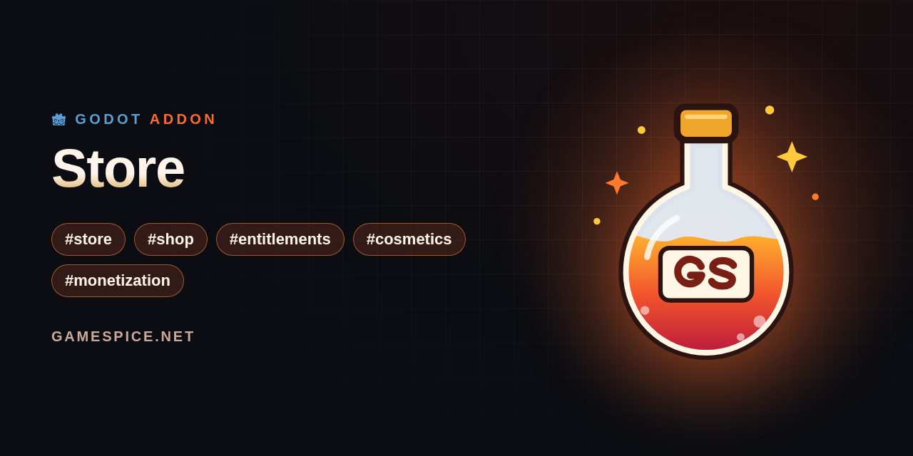

[](https://moddingcommunity.com/a/150-gs-store)

Godot 4.7+ addon for a catalogue and checkout of cosmetics, passes and bundles: prices, entitlements a dedicated server can check, and purchase intents handed to the TMC backbone. It never handles payment details. Part of the [GameSpice](https://github.com/gamespice-platform) addon family. It needs only [GameSpice Core](https://github.com/gamespice-platform/core).

A catalogue is plain data. A player's entitlements are one small Dictionary (`owned`). Checkout turns a cart into a purchase intent: a priced, expiring, deterministic document the backbone settles. The game never sees a card number, and any request carrying one is refused.

## Install

1. Copy `addons/dot_store/` and `addons/dot_core/` into your project.
2. Enable dot-store in *Project > Project Settings > Plugins*.

## Quick start

```gdscript
var cfg := DotStoreConfig.from_files().value      # defaults, cfg/addon/dot_store/*.yml, DOT_STORE_*, --store-*
var cat := DotStoreCatalogue.from_dict({"items": [
    {"id": "skin_a", "kind": "cosmetic", "price": 300},
    {"id": "spray_b", "kind": "cosmetic", "price": 100},
    {"id": "starter", "kind": "bundle", "price": 350, "contents": ["skin_a", "spray_b"]}]}).value

var ent := DotStoreEntitlements.create()          # {owned: []}
var now := int(Time.get_unix_time_from_system())
var intent := DotStoreIntent.build(cfg, cat, ent, player_id, ["starter"], now)
if intent.ok:
    pass  # hand intent.value to the backbone; it settles payment on its own side

# the backbone re-prices it, then the game grants what was bought
if DotStoreIntent.verify(cat, intent.value, now).ok:
    ent = DotStoreEntitlements.fulfil(ent, cat, intent.value).value["entitlements"]

# a dedicated server gating a cosmetic
if DotStoreEntitlements.check(ent, ["skin_a"]).ok:
    pass
```

## Sales, timed items and refunds

An item may carry `sale: {price, from?, until?}`, `duration` (seconds the entitlement lasts; 0 is for good) and `requires: [ids]` that must already be owned. `price_at(id, now)` gives the price a cart pays; `DotStoreIntent.verify` checks a line against the price at the intent's creation time. `DotStoreEntitlements.grant(ent, cat, id, now)` starts the clock of a timed item (buying again extends it); `owns_at`, `prune` and `expiring` read it; `revoke` takes an item back for a refund. Pass `now` as 0 to grant timed items for good. See `examples/store_demo.gd`.

## Settings

Every number is a field on `DotStoreConfig`. A zero in a limit means unlimited.

| Setting | Default | What it does |
| --- | --- | --- |
| `enabled` | true | Off, no intent is built. |
| `currency` | `coins` | Label on every intent. |
| `max_cart_lines` | 0 | Most lines in a cart; 0 is unlimited. An over-limit cart is refused, never trimmed. |
| `intent_ttl_seconds` | 900 | How long an intent stays valid; 0 never expires. |
| `refuse_owned` | true | Refuse an intent for something already fully owned. |

## What it is not

- Not a payment processor: no card, bank or billing detail is accepted, stored or logged. `DotStoreIntent.check_request` refuses any request carrying such a key.
- Not round-based money: GameSpice Economy runs buy rounds inside a match. Store sells things between matches.
- Not inventory or loadouts: those consume entitlements. Store only says what a player owns.
- Not progression: GameSpice Progression names battle-pass rewards, the Store sells the pass.
- Not storage: keep entitlements with GameSpice Save or your own backend.

## Test

```bash
godot --headless --path . --import
godot --headless --path . res://examples/store_selftest.tscn
```

The self-test is offline and exits non-zero on any failure.

## Status

Built and maintained with Claude Code. The test suites pass, but little of this has been in front of real players yet. Please report rough edges by opening an issue.

## Licence

MIT. See [LICENSE](LICENSE). Only the TMC back-end web infrastructure is not open source.
